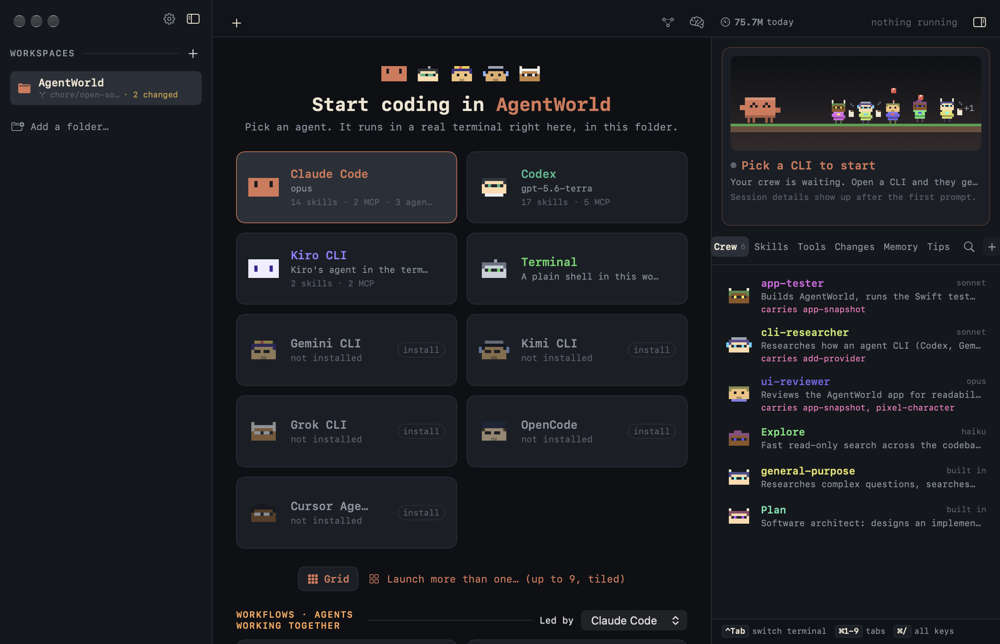
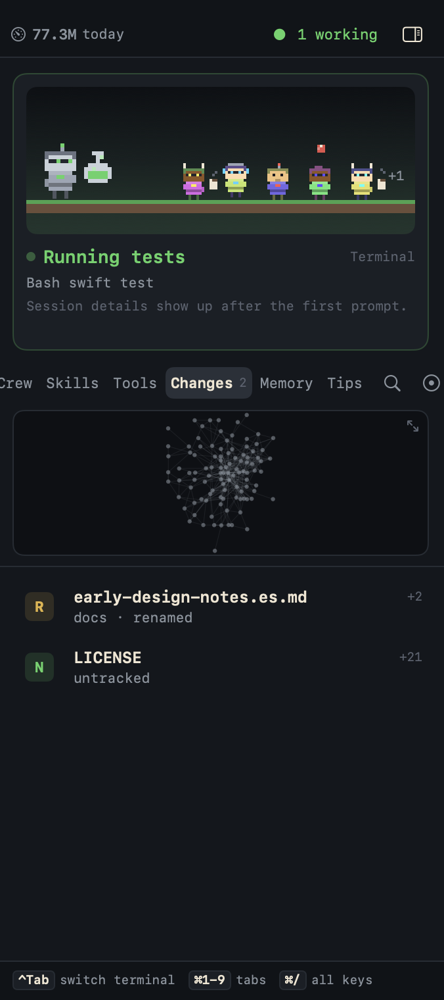

# AgentWorld

**One macOS window for all your coding-agent CLIs, with a memory and a message board they share.**

Run Claude Code, Codex, Gemini CLI, Kimi, Grok, OpenCode, Cursor Agent or Kiro
side by side in real terminals. AgentWorld reads what each one already writes to
disk, shows what every agent is doing, and lets different CLIs in the same
project share notes and talk to each other.



## Why

If you use more than one agent CLI, you probably already keep your own
`HANDOFF.md` or `NOTES.md` so the next session (or the next tool) knows what
happened. AgentWorld makes that a built-in feature instead of a habit:

- **Shared memory across CLIs.** Plain Markdown notes, per project and global,
  stored in `~/AgentWorld/Memory`. Any CLI can search, read and write them
  through `agentworld-ctl memory` or as MCP tools. A built-in view shows the
  notes with `[[links]]` and backlinks.
- **Agents in touch.** A board of who is doing what and which files each one
  edited, messages between agents in the same workspace, and a warning when two
  of them edit the same file.
- **See what happened.** Uncommitted files, which agent touched each one, and
  the diff, whichever CLI it was.

## What else it does

- **Real terminals** (via [SwiftTerm](https://github.com/migueldeicaza/SwiftTerm))
  through your login shell, with tabs, a tiled grid of up to 9 panes and
  resume tab by tab.
- **A panel per CLI** listing its agents, skills, commands, plugins and MCP
  servers, read from that CLI's own config folders.
- **Pixel characters** that act out what each agent is doing, for the fun of it.
- **Token usage** by CLI, day and session (Claude Code, Codex, Gemini CLI).
- **Project map**: your files as a graph of who uses whom, with live rings on
  what the agents are editing, and `agentworld-ctl map` so agents can ask for
  the structure themselves.
- **Agents drive the app.** With `agentworld-ctl` (and the bundled `agentworld`
  skill) an agent can open helper panes beside it, hand off work and read the
  answers.
- **⌘K palette**, a commit sheet (⌘⇧C), and keyboard-first navigation.



## How it works, and what it touches

AgentWorld hosts each CLI in a terminal and **never talks to the CLIs
directly**: it reads what they already write (for example Claude Code's session
transcripts under `~/.claude/projects`, Codex's rollouts, Gemini's chats) and
each CLI's config folders. It talks to the agents running inside it over a
local socket.

On privacy: the app's own source contains no networking code and no telemetry,
so it makes no network requests of its own. The CLIs you run inside it, and
`git` when you clone or push from it, talk to their own services as usual.
Shared notes are plain Markdown files on your disk.

## Install

AgentWorld is built from source for now (it is not notarized, so a downloaded
build would trigger Gatekeeper warnings; building locally avoids that).

Requirements: macOS 13+, Xcode 16+ with a Swift 6 toolchain.

```sh
git clone https://github.com/rogergongas8/AgentWorld.git
cd AgentWorld/Sidebar
make app        # builds, ad-hoc signs and installs to /Applications
```

Then open **AgentWorld** from Spotlight, or run `agentworld` in a terminal to
open it on that folder.

If the build stops at SwiftTerm's Metal shaders, your Xcode is missing its Metal
Toolchain component. Install it from Xcode's Settings › Components, or with
`xcodebuild -downloadComponent MetalToolchain`.

## Status

Early and moving fast. It is a macOS-only app developed mainly by one person,
tested mostly with Claude Code, Codex and plain shells; other CLIs are
supported by reading their config and logs and may have rough edges. See the
[roadmap](Sidebar/ROADMAP.md) and the [app docs](Sidebar/README.md). Bug
reports with the CLI and version you use are very welcome.

## Contributing

Issues and pull requests are welcome. `make test` (from `Sidebar/`) runs the
suites. The repository includes skills for coding agents under `.claude/` and
`.agents/` that explain how to add a provider, drive the app for screenshots
and run a release check.

## Credits and trademarks

Built with [SwiftTerm](https://github.com/migueldeicaza/SwiftTerm) (MIT) and
[swift-argument-parser](https://github.com/apple/swift-argument-parser)
(Apache-2.0). Claude Code, Codex, Gemini, Kimi, Grok, OpenCode, Cursor and Kiro
are names and trademarks of their respective owners. AgentWorld is an
independent project and is not affiliated with or endorsed by any of them.

## License

[MIT](LICENSE)
